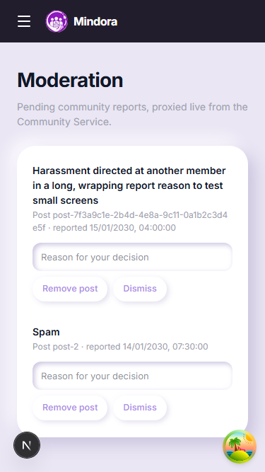
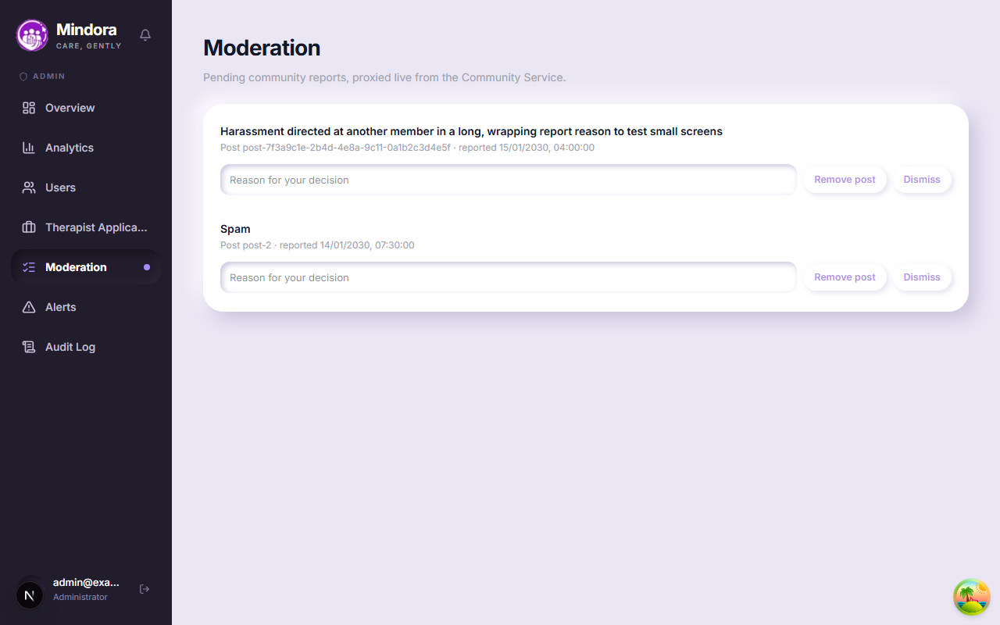
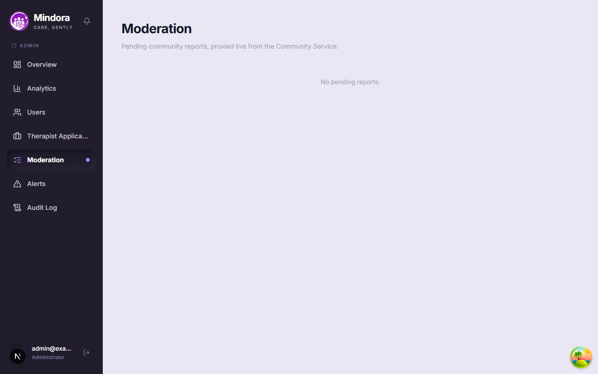
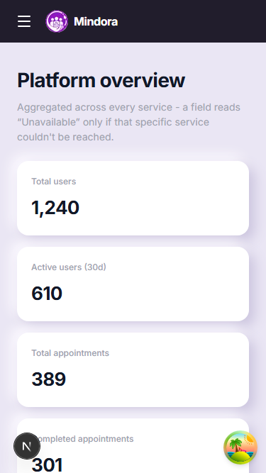
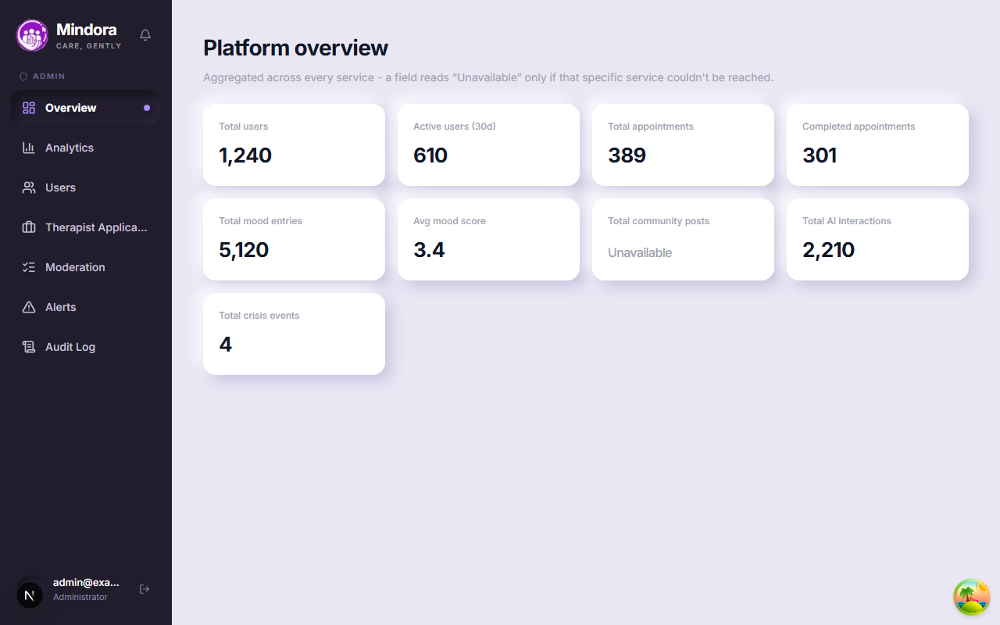

# Admin fixes evidence (Step 5)

Captured against the local dev server with every API response mocked (no real backend). Admin role token is faked; no real data.

## Moderation with reports

At 375px the report text wraps, the post id breaks instead of overflowing, and the reason field and buttons wrap onto their own lines.

At 1280px.

## Moderation empty

## Main admin page

Nine stat tiles (the loading skeleton now also shows nine). A field the backend reports as null reads "Unavailable".

Error and loading states for moderation, alerts, applications and the main page are covered by `src/app/admin/admin-pages.test.tsx`. The Playwright run also asserted error and empty states and no horizontal overflow at 375 and 1280 for all four pages.
