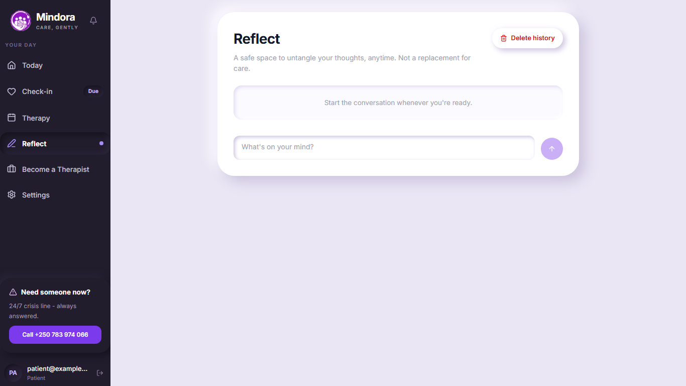
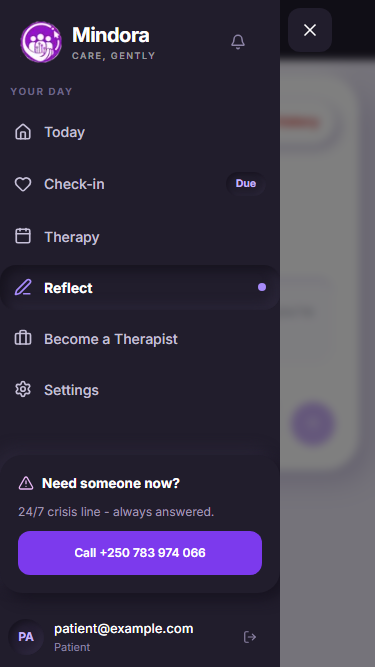
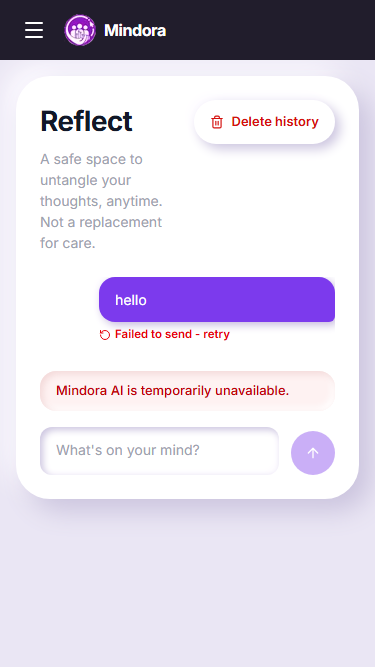

# Reflect rework - Phase B (UI removals)

Captured with Playwright against a production build, with all API responses mocked (no backend, no real alerts).

- Messaging is removed entirely: the `/messages` route, `MessagesView`, `useMessaging`, the messaging API and socket client, the messaging types, the `socket.io-client` dependency and the `NEXT_PUBLIC_SOCKET_URL` setting. The therapist card's "Get started" now opens the booking dialog directly (the "Chat with this therapist" choice is gone).
- 112 is no longer shown or linked anywhere (sidebar, mobile top bar, chat notice, chat failure banner, crisis overlay). The Mindora crisis line (+250 783 974 066) is the only crisis call action.

## Patient sidebar, 1366x768

## Mobile drawer, 375px

## Chat failure banner, 375px

