# Responsive pass evidence (375px)

Screenshots of pages changed in the FE2 responsive pass, taken against mocked API responses (no real backend). Left is before, right is after. Dev-tool buttons in the corners belong to the dev server, not the app.

## Therapy: browse

Filter selects and tabs are now 44px tall.

Before: 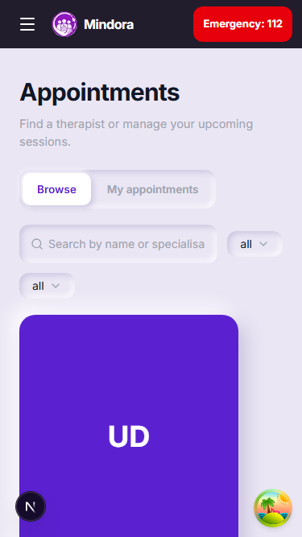

After: 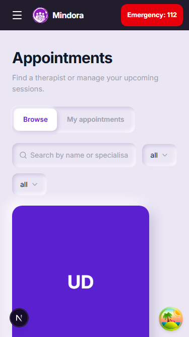

## Therapy: therapist card after a tap

Before: tapping does nothing on touch, so the "Get started" action on the back face cannot be reached. After: a tap flips the card, a back button flips it again, and "Get started" is a 44px button.

Before: 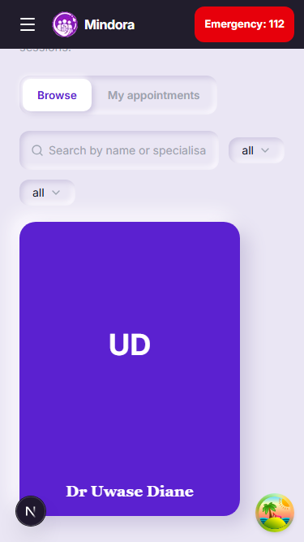

After: 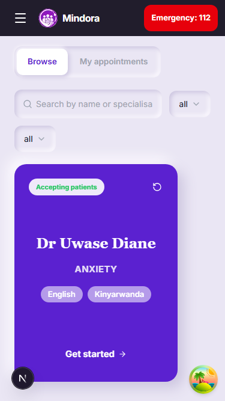

## Therapy: my appointments

Status tabs and the Cancel / Rate buttons are 44px tall.

Before: 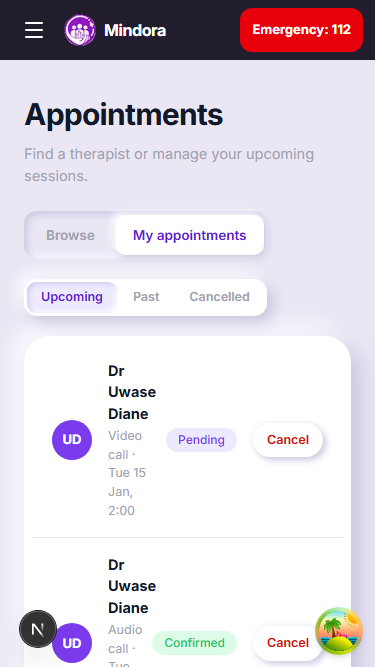

After: 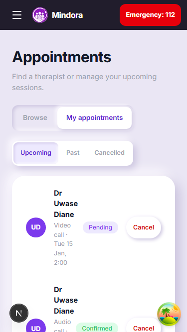

## Booking dialog

Session type and time-slot buttons are 44px tall; the close button is 44px.

Before: 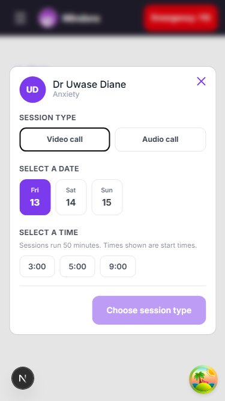

After: 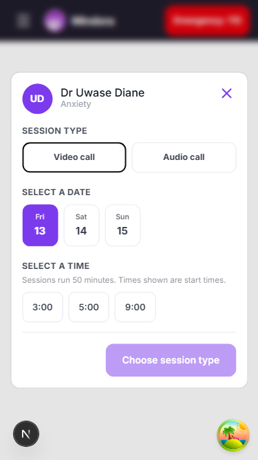

## Therapist schedule

Mood, Confirm and Mark complete buttons are 44px tall.

Before: 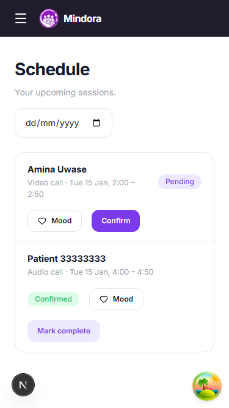

After: 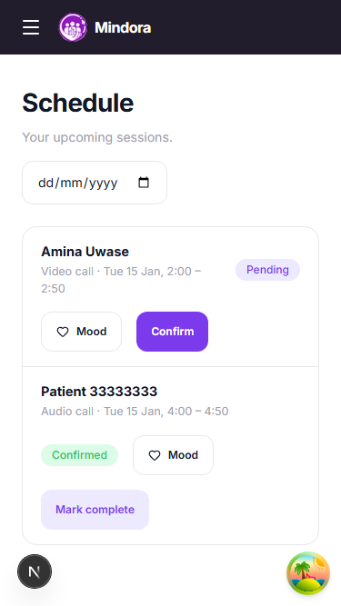

## Admin analytics

Date-range presets are 44px tall.

Before: 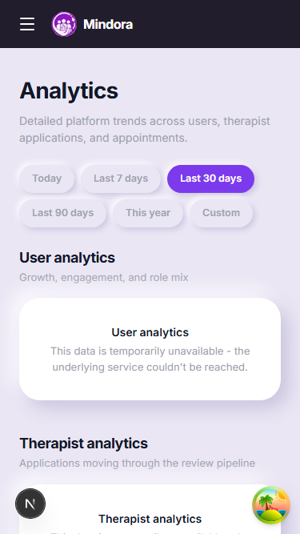

After: 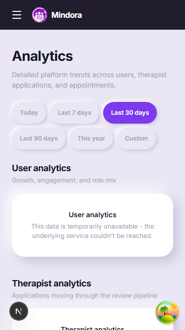

## Admin users

Suspend / Reactivate and the role filter are 44px tall.

Before: 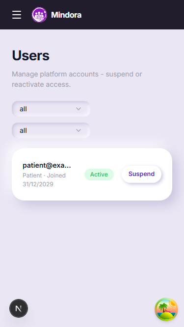

After: 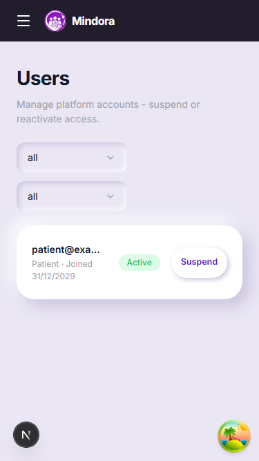

## Admin alerts

Resolve button is 44px tall.

Before: 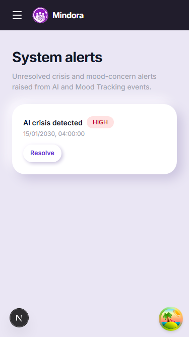

After: 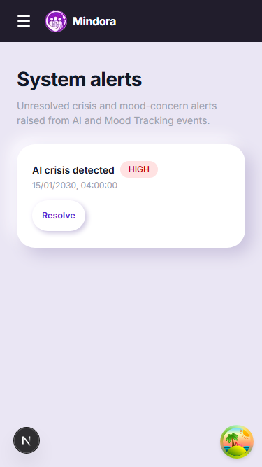

## Admin moderation

Remove post, Dismiss and the reason field are 44px tall.

Before: 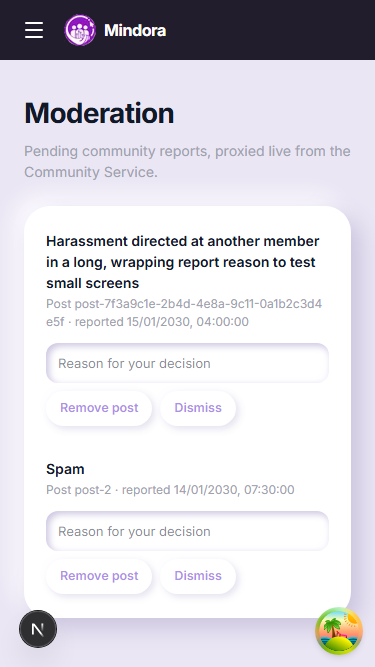

After: 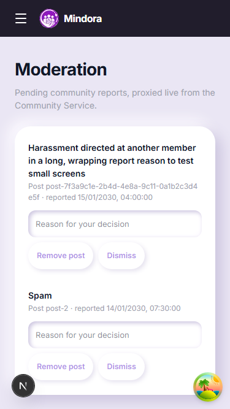

## Therapist navigation drawer

Nav links, notifications and sign-out are 44px tall.

Before: 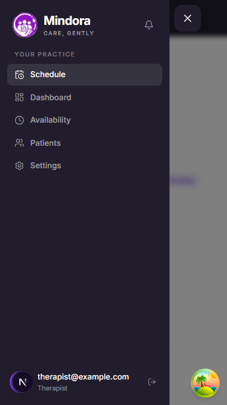

After: 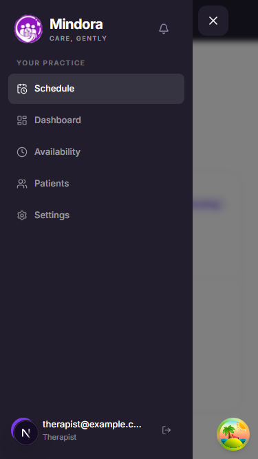
