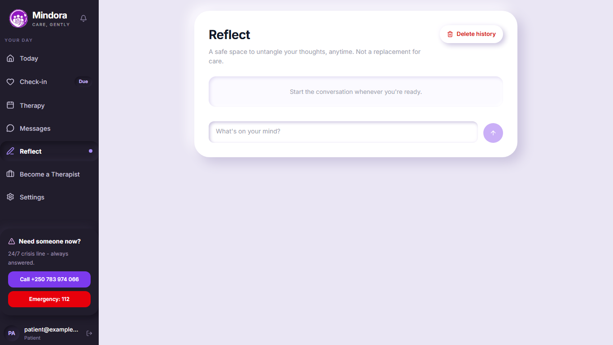
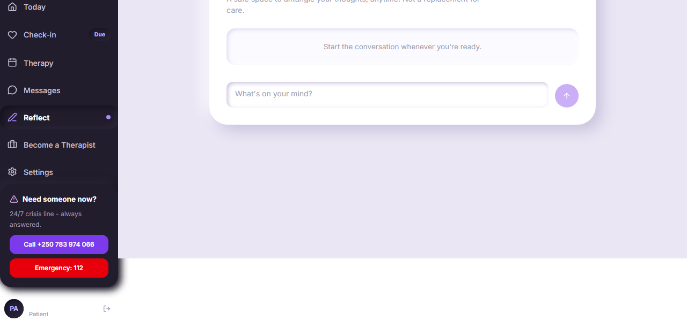
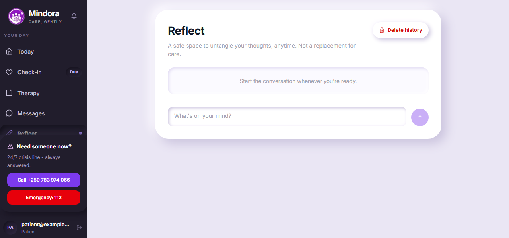
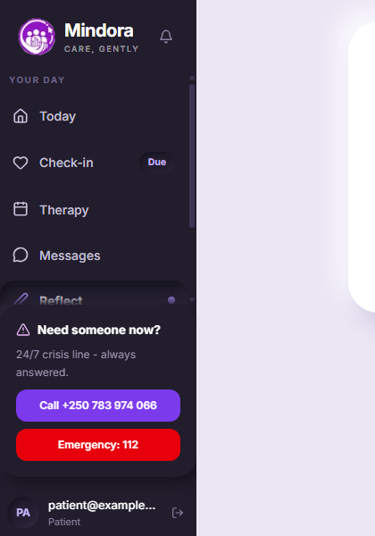
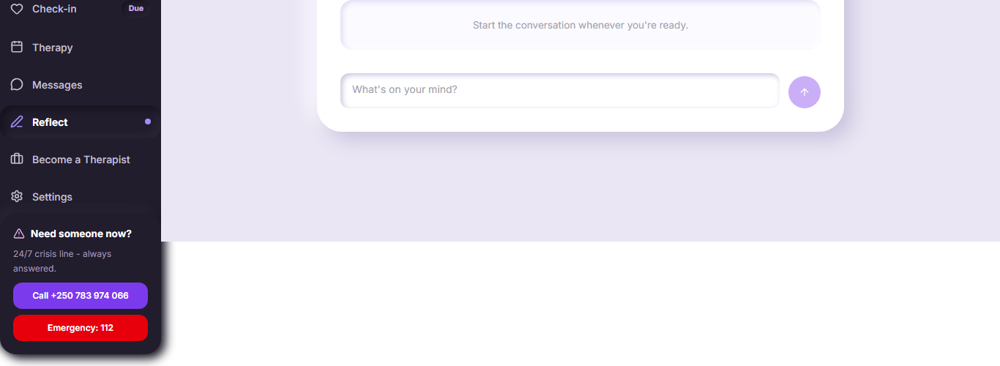
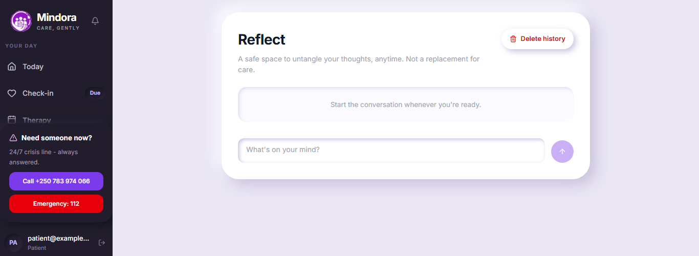
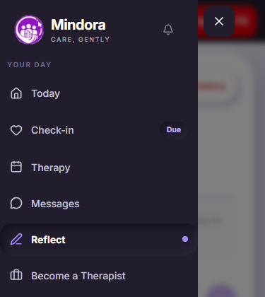
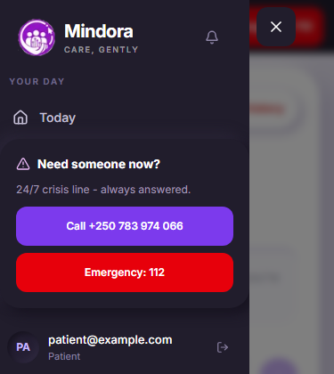

# Sidebar fit on short viewports

On short screens the patient sidebar was taller than the viewport. The shell is `h-dvh overflow-hidden`, but the nav list had no `min-h-0` / overflow, so it pushed the `<aside>` past the viewport and the shell clipped it: the logo and top nav items were cut off and the user chip hung below the page background.

Fix (4 class additions per sidebar, in `AppSidebar`, `TherapistSidebar`, `AdminSidebar`): `min-h-0` on the aside, `shrink-0` on the logo header and on the bottom block (crisis card + user chip), and `min-h-0 overflow-y-auto` on the nav. The nav now scrolls; the crisis card, **Emergency: 112** and the user chip stay pinned. Colours, copy, 44px tap targets and tall-screen layout are unchanged.

Screenshots are of `/reflect` as a patient, taken with mocked API responses (no real backend). Measurements are from `e2e-evidence/sidebar-fit-evidence.mjs`.

## 1366x768

Before: 

After: 

At this height the nav fits, so the layout is unchanged apart from no longer being clipped.

## 1280x600

Before (sidebar spans -117..483px: top cut off, user chip below the page): 

After (sidebar 0..600px, nav scrolls, card and chip pinned): 

Scrollbar (nav list, 1280x600): thin, transparent track, thumb `#3d3652` on the `#211d2c` sidebar, set with `scrollbar-width: thin` and `scrollbar-color` on the nav only. 

## 1366x500 (extra, very short)

Before: 

After: 

## Mobile drawer, 375x420

Before (Emergency: 112 at y=635, below the 420px viewport): 

After (drawer fits, nav scrolls, Emergency: 112 at y=328): 

## After-fix measurements (px, from the viewport top)

| Viewport | Sidebar | Nav scrolls | Crisis card | Emergency: 112 | User chip | Page scrolls |
| -------- | ------- | ----------- | ----------- | -------------- | --------- | ------------ |
| 1366x768 | 0-768   | no          | 509-702     | 648-684        | 729-755   | no           |
| 1280x600 | 0-600   | yes         | 341-534     | 480-516        | 561-587   | no           |
| 1366x500 | 0-500   | yes         | 241-434     | 380-416        | 461-487   | no           |

The crisis card, Emergency: 112 and the user chip are inside the viewport at all three sizes without scrolling the page. Therapist and admin sidebars (no crisis card) also fit at 1280x600 with the user chip visible (chip 549-575 and 541-567).

Limits: the "before" run only measured sidebar bounds and the chip reliably; its crisis-card check used a selector that did not match, so the before state for the card is shown by the screenshots rather than numbers. Checked at desktop widths and one phone drawer size in headless Chromium, not on physical devices.
