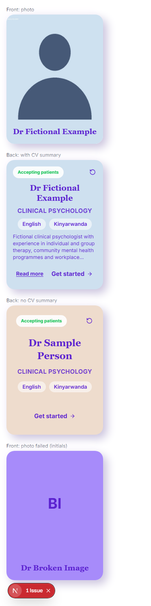
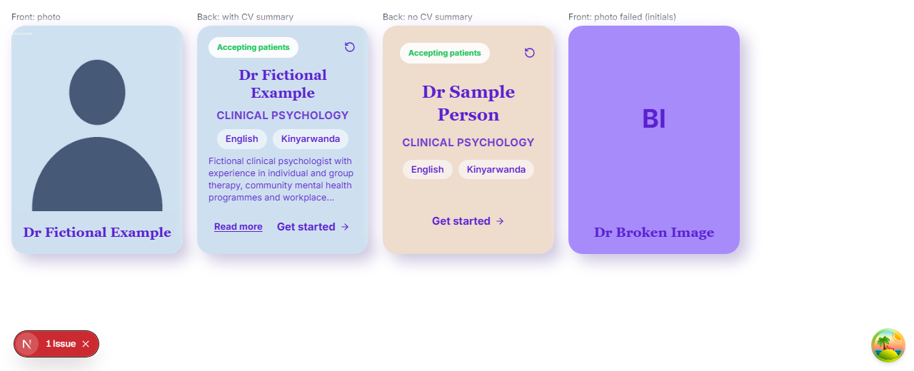

# Therapist headshot and CV summary on the therapy card

All data and images here are **fictional**. The people are made up and the photos are generated
placeholder silhouettes. No real therapist photo or CV was used.

Screenshots were taken from a throwaway harness that rendered `TherapistCard`
(`src/components/therapy/TherapistCard.tsx`) with fixed props. The harness was deleted
afterwards and is not part of the change. The card was forced to its back face with CSS only.

Each page shows four cards:

1. **Front: photo.** The headshot is top-aligned (`object-cover object-top`), so faces are not cropped.
2. **Back: with CV summary.** The summary is clamped to 4 lines. "Read more" links to the full
   profile at `/therapists/<userId>`, where the whole summary is shown under "Professional summary".
3. **Back: no CV summary.** There is no CV block and no "Read more", and the layout is unchanged.
4. **Front: photo failed.** The card falls back to the initials.

## 375 px (mobile)

## 1280 px (desktop)

The small "N" and "Issue" badge at the bottom-left is the Next.js dev-mode indicator, not part of the UI.
