# Therapist dashboard fixes evidence (Step 6)

Captured against the local dev server with every API response mocked (no real backend). The therapist role token is faked; all names and ids are made up.

## Schedule

Patient name (from the patients list), session type, start and end time, status and actions. At 375px the name keeps a minimum width and the status and buttons wrap below it.

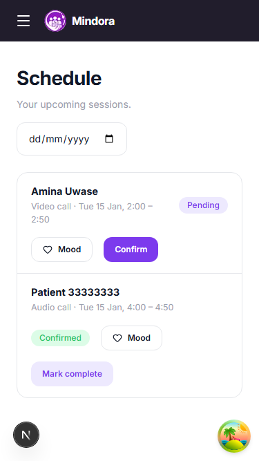

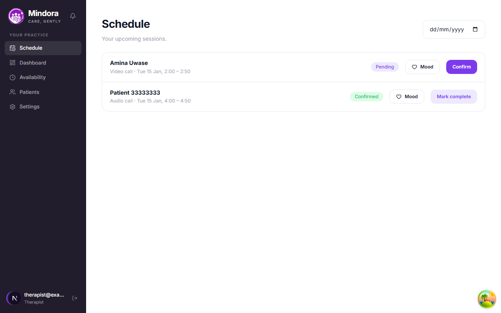

Empty:

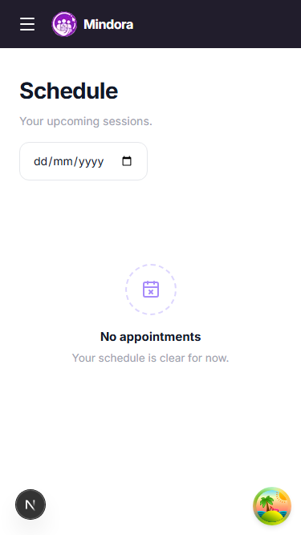

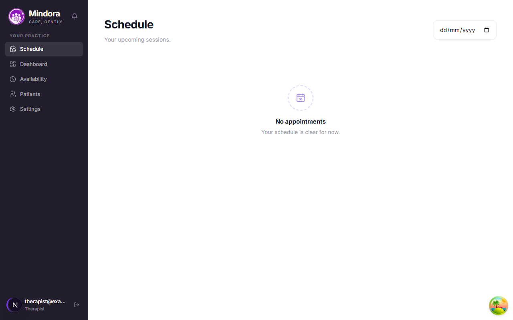

## Dashboard

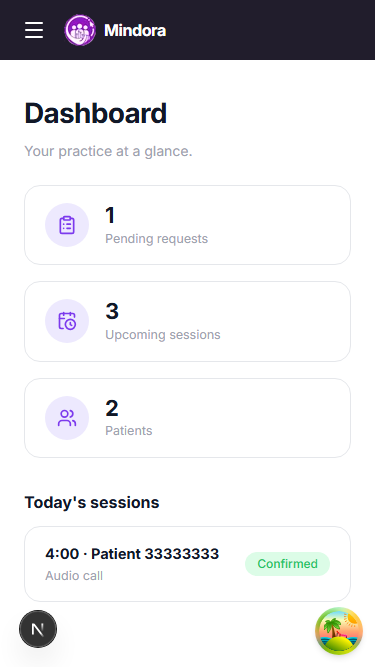

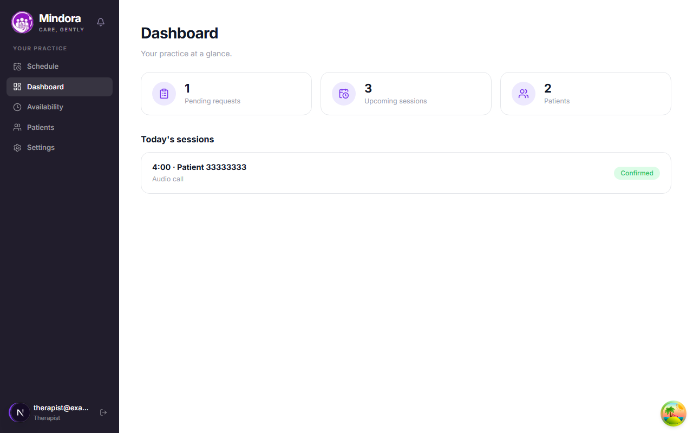

Empty:

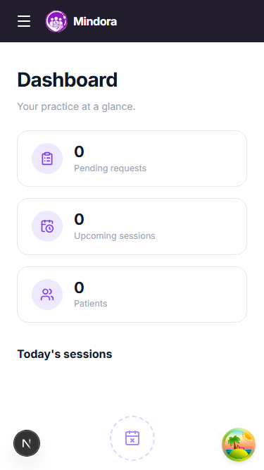

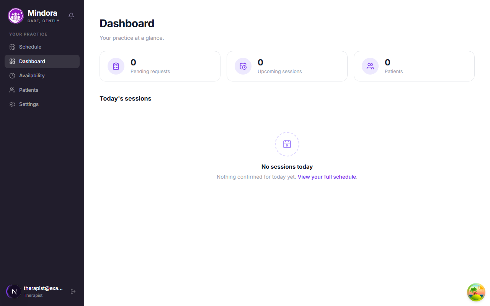

## Patients

At 375px the fixed-width columns (which overflowed) become a stacked card per patient.

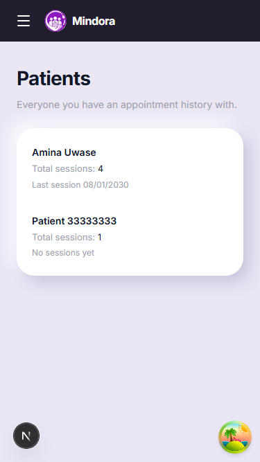

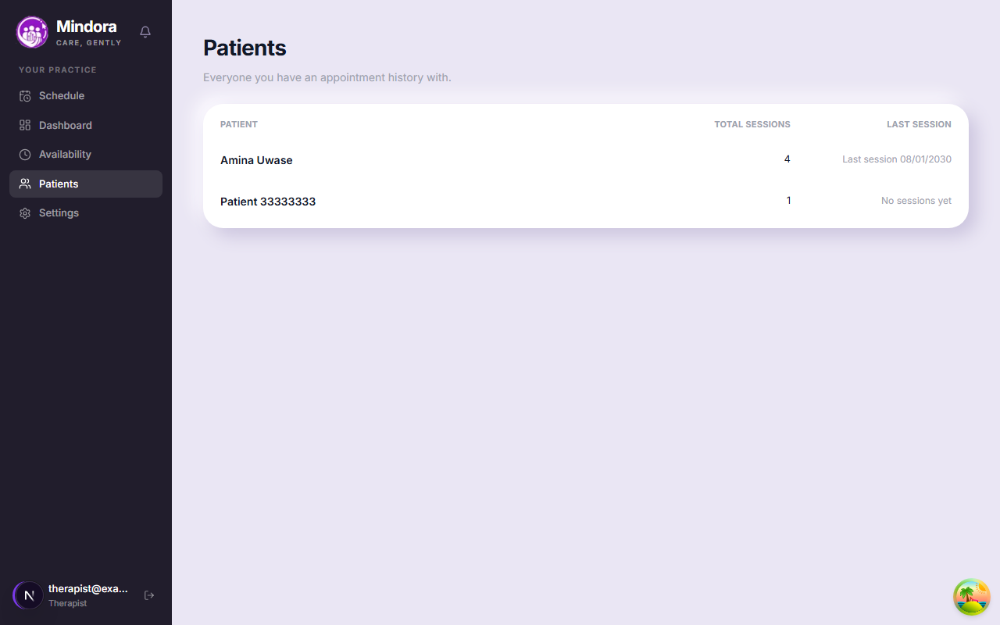

Empty:

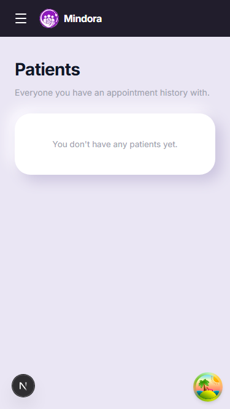

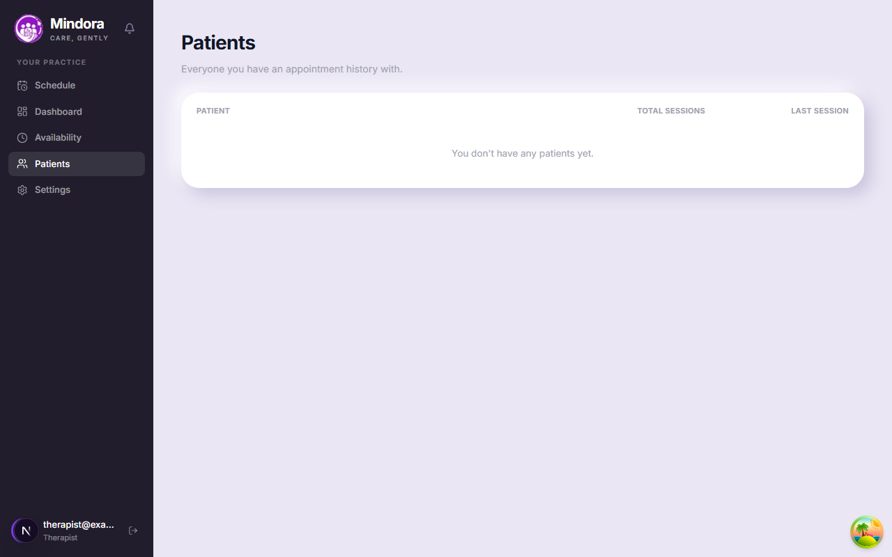

Loading and error states are covered by `src/app/therapist/therapist-pages.test.tsx`. The Playwright run also asserted data, empty and error states at 375, 768 and 1280, no horizontal overflow, and (dashboard error) no misleading zero stats: 66 checks passed.
